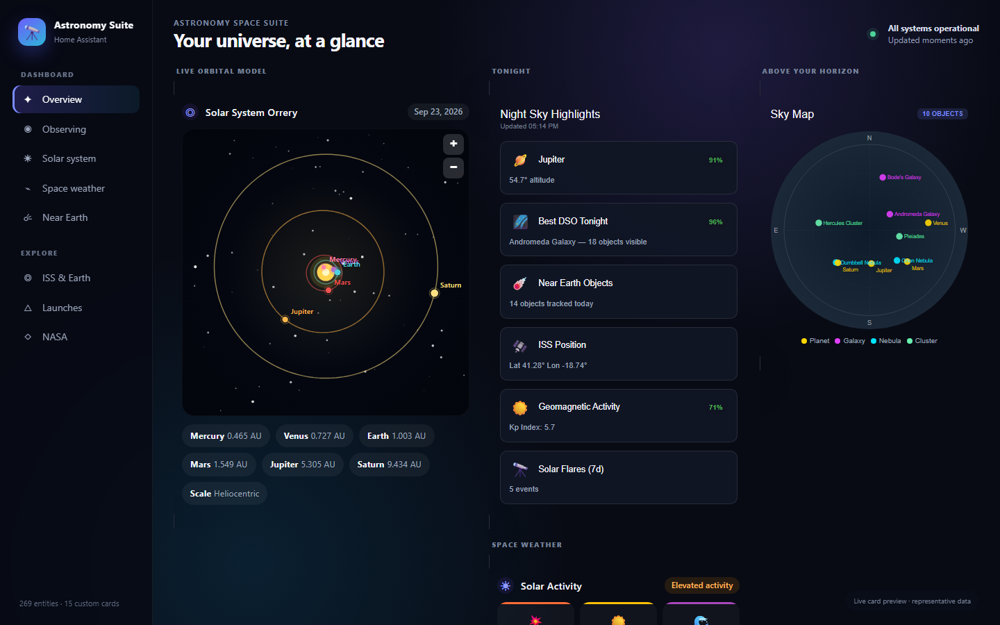
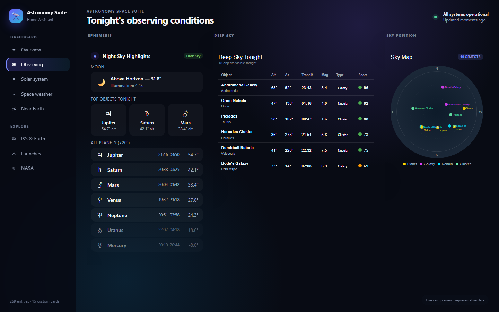

# 🔭 Home Assistant Astronomy Space Suite (ASS)

[](https://my.home-assistant.io/redirect/hacs_repository/?owner=snfx-johaver&repository=home-assistant-astronomy-suite&category=integration)

The most complete astronomy and space dashboard for Home Assistant. Yes, I know what the acronym spells — and no, I'm not changing it. The universe has a sense of humor, and so do I 🍑🚀

Fully isolated — does not modify any existing dashboards, integrations, or resources.

<p align="center">
  
</p>

<p align="center"><sub>One dashboard for orbital positions, observing conditions, space weather, satellites, launches, and NASA imagery. Representative data shown.</sub></p>

---

## ✨ Features

### 🛰️ Sensors (17+ NASA + 120+ Ephemeris + 121 Deep-Sky)
| Sensor | Source | Auth |
|--------|--------|------|
| Astronomy Picture of the Day (APOD) | NASA | API key |
| Near Earth Objects (count, closest, fastest, largest) | NASA NeoWs | API key |
| Coronal Mass Ejections (7-day) | NASA DONKI | API key |
| Solar Flares (7-day) | NASA DONKI | API key |
| Geomagnetic Storms (30-day) | NASA DONKI | API key |
| Earth Events (EONET) | NASA | API key |
| Tech Transfer Patents | NASA | API key |
| Rocket Launch 1–5 | RocketLaunch.Live | Optional |
| ISS Position (lat/lon) | Where The ISS At + CelesTrak/SGP4 fallback | None |
| Planetary KP Index (aurora) | NOAA SWPC | None |
| **Ephemeris: Sun** (alt, az, RA, dec, twilight times) | Local calc | None |
| **Ephemeris: Moon** (alt, az, phase, illumination) | Local calc | None |
| **Ephemeris: Planets** (Mercury–Neptune positions) | Local calc | None |
| **Sky Conditions** (twilight phase, sidereal time, day length) | Local calc | None |
| **Deep-Sky Objects** (30 DSOs × 4 sensors each + Best Tonight) | Local calc | None |

### 📷 Cameras (8)
| Camera | Source | Auth |
|--------|--------|------|
| APOD Image | NASA | API key |
| EPIC Earth (full-disk natural color) | NASA | None |
| GOES-16 Earth (Americas) | NOAA | None |
| GOES-18 Earth (Pacific) | NOAA | None |
| Himawari-8 Earth (Asia/Pacific) | NICT Japan | None |
| Meteosat-12 Earth (Europe/Africa GeoColour RGB) | EUMETSAT / NASA | None |
| SDO Sun (171Å corona, extreme UV) | NASA | None |
| SOHO Sun (LASCO C3 coronagraph) | ESA/NASA | None |

### 🃏 Custom Lovelace Cards (16)
All cards are prefixed **"ASS"** in the card picker for easy discovery.

<p align="center">
  
</p>

| Card | Bundle | Description |
|------|--------|-------------|
| `apod-card` | astronomy-cards.js | Astronomy Picture of the Day with metadata |
| `neo-threat-card` | astronomy-cards.js | Near Earth Object tracker with threat levels |
| `solar-activity-card` | astronomy-cards.js | CME/Flare/Storm monitor + KP gauge + live Sun |
| `astro-horizon-card` | astronomy-cards.js | Sun arc horizon visualization |
| `astro-lunar-card` | astronomy-cards.js | Moon phase visualization |
| `solar-system-card` | astronomy-cards.js | Real-time heliocentric orrery (orbital mechanics) |
| `rocket-launch-card` | astronomy-cards.js | Next 5 launches with countdown timers |
| `iss-tracker-card` | astronomy-cards.js | Native Home Assistant map with ISS history trail + live stream |
| `earth-observation-card` | astronomy-cards.js | Multi-source satellite imagery (EPIC, GOES, Himawari, Meteosat, SDO, SOHO) |
| `night-sky-highlights-card` | astronomy-cards.js | Best visible planets tonight and locally visible solar/lunar eclipses |
| `observation-planner-card` | astronomy-cards.js | Darkness, weather layers, observing quality and best viewing windows |
| `night-sky-highlights-2-card` | deepsky-cards.js | Auto-detecting highlights tile grid (planets, DSO, NEO, ISS, KP, flares) |
| `dso-tonight-table-card` | deepsky-cards.js | Sortable table of visible deep-sky objects |
| `dso-yard-map-card` | deepsky-cards.js | Polar projection sky map (SVG) |
| `dso-panorama-card` | deepsky-cards.js | 360° horizon strip panorama |
| `dso-dome-card` | deepsky-cards.js | Interactive 3D sky dome (drag to rotate) |

### 🛡️ Isolation Guarantees
- ✅ All entity IDs namespaced under `astronomy_space_suite_` / `nasa_astronomy_`
- ✅ Custom cards use unique Shadow DOM elements (no global CSS)
- ✅ Does NOT modify any existing dashboards or resources
- ✅ Cards JS auto-deployed and auto-registered on setup
- ✅ Separate integration domain — no shared state

---

## 📦 Installation

### Via HACS (Recommended)

1. Open HACS in your Home Assistant
2. Click the button above, or manually add as a custom repository:
   - URL: `https://github.com/snfx-johaver/home-assistant-astronomy-suite`
   - Category: **Integration**
3. Click **Download**
4. **Restart Home Assistant**
5. Go to **Settings → Devices & Services → Add Integration**
6. Search for **Astronomy Space Suite**
7. Enter your NASA API key (get one free at [api.nasa.gov](https://api.nasa.gov/))
8. Optionally enter your RocketLaunch.Live API key (or leave blank for free tier)
9. Configure Ephemeris (enabled by default — uses your HA location)
10. Configure Deep-Sky Objects (enabled by default — 30 curated DSO targets)

**That's it!** The integration automatically:
- Deploys both card bundles (`astronomy-cards.js` + `deepsky-cards.js`) to your `www/` folder
- Registers both bundles as Lovelace resources
- Creates all sensors, cameras, and deep-sky entities

No manual file copying. No YAML editing. Just install, restart, configure.

### Private observing-intelligence preview

**Find your next clear window, see what is worth watching, and plan satellite
passes from home.** This unreleased expansion retains version **1.19.1**;
install the preview only on your own Home Assistant for evaluation. Do not
merge or run a release until the private rollout is approved.

Night Sky Highlights now includes an event ribbon. The existing Moon, Solar
Activity and ISS cards gain intelligence without changing their card names.
The new **Observation Planner** joins the Observing view; it does not replace
Best Tonight, the horizon, sky maps or any existing eclipse sensor.

In **Settings → Devices & Services → Astronomy Space Suite → Configure**:
enable **Observing conditions**, **Space-weather forecast**, or **Satellite
passes** independently. They are off by default. **Celestial events** is local
and enabled by default when ephemeris is enabled. All new calculations use the
configured ephemeris location and elevation. Changing options reloads and
invalidates the location-dependent caches.

| Capability | Source and cadence | Fallback |
|---|---|---|
| Events and lunar intelligence | Existing Astronomy Engine; events cached daily, Moon on ephemeris cadence | No internet needed |
| Observing forecast | One Open-Meteo request/hour; local evaluation every 15 min | Last successful forecast for up to 6 hours |
| Kp and NOAA scales | NOAA SWPC hourly, shared by the NASA coordinator | Up to 6 hours |
| Flare/radiation probabilities | NOAA SWPC every 3 hours | Up to 12 hours; old issuance rejected |
| Local aurora outlook | NOAA OVATION every 30 min; nearest geographic cell | At most 2 hours |
| Sunspots and solar flux | NOAA monthly observations, retrieved daily | Up to 7 days |
| Selected satellites | CelesTrak OMM every 12 hours; existing ISS two-hour cadence retained | Valid elements stored locally; never older than 7 days |

Open-Meteo is the only new weather provider: no key, overlapping weather
services or separate integration required. Its free endpoint is for
non-commercial use and its weather data is **CC BY 4.0**; commercial users
must check [Open-Meteo's terms](https://open-meteo.com/en/terms). NOAA is the
authoritative space-weather source. CelesTrak remains the single orbital
source; OMM is used instead of introducing a separate TLE download pipeline.
NASA and RocketLaunch.Live calls and keys are unchanged.

Requests have explicit timeouts, share in-flight work, back off after failures
and rate limits, and validate responses before replacing caches. Optional
providers fail independently; unavailable forecast hours stay unknown. Cached
forecasts are labelled, and diagnostics report age and exception type without
keys or observer coordinates. Weather and NOAA caches are in memory; only
satellite orbital elements persist across restarts.

#### Planner, event and satellite cards

```yaml
type: custom:observation-planner-card
entity: sensor.astronomy_space_suite_observing_score
mode: stargazing # deep_sky or astrophotography
hours: 48 # 24–48
show_targets: true
glass_mode: false
```

The ribbon shows darkness, cloud layers, seeing/clarity estimates and
moonlight. A clear window is highlighted; Best Tonight's existing target
coordinates are evaluated inside that window (up to five targets). The plotted target
peaks follow the general stargazing window, not a separately
optimized imaging sequence. Narrow cards scroll the timeline rather than
squeezing hour labels into unreadable text.

```yaml
type: custom:night-sky-highlights-card
events_entity: sensor.astronomy_space_suite_next_celestial_event
show_events: true
show_eclipses: true
```

```yaml
type: custom:astro-lunar-card
moon_entity: sensor.moon_phase # existing setting remains valid
intelligence_entity: sensor.nasa_astronomy_ephemeris_moon_illumination_pct
```

The Moon card can use the suite's illumination entity alone when the optional
Home Assistant Moon integration is absent. Calculated phase times replace the
legacy approximate phase countdown when intelligence is available. Its distance
gauge and 24-hour altitude arc use local calculations, not decorative positions.

```yaml
type: custom:solar-activity-card
cme_entity: sensor.astronomy_space_suite_coronal_mass_ejections
flare_entity: sensor.astronomy_space_suite_solar_flares
storm_entity: sensor.astronomy_space_suite_geomagnetic_storms
kp_entity: sensor.astronomy_space_suite_planetary_kp_index
forecast_entity: sensor.astronomy_space_suite_space_weather_forecast
observing_entity: sensor.astronomy_space_suite_observing_score
```

For satellite passes select NORAD IDs in options, for example
`25544,20580,48274` (ISS, Hubble, Tiangong). At most **eight** may be selected;
there is no default constellation or browser-side position API.

```yaml
type: custom:iss-tracker-card
entity: sensor.astronomy_space_suite_iss_position
mode: satellites # default: iss
satellite_entities: sensor.astronomy_space_suite_satellite_20580,sensor.astronomy_space_suite_satellite_48274
show_stream_button: false
```

The existing native map, history and resize behavior are preserved. The
selected satellite's next pass is drawn in a north-up horizon plot, with a
bounded predicted ground track using the bundled map.

#### Entities and accuracy

| Entity suffix under `sensor.astronomy_space_suite_` | State / attributes |
|---|---|
| `next_celestial_event` | Next event title; at most 48 events, shared eclipse references, peak/start/end, local geometry |
| `next_meteor_shower` | Next shower title; one detailed event |
| `observing_score` | Current 0–100 score; at most 48 hourly evaluations, three mode scores, windows and up to five targets |
| `observing_status` | GO, MARGINAL or NO-GO; unavailable without sufficient forecast |
| `best_observing_window` | UTC start timestamp string; start/end and limiting factor attributes |
| `space_weather_forecast` | Quiet/Elevated outlook; bounded Kp series, 3-day probabilities, NOAA scales, monthly solar trend and aurora |
| `satellite_<NORAD ID>` | Position for selected non-ISS satellites only; at most 6 passes, 30 sky-path samples/pass and 60 ground-track points |

Existing unique IDs, domain, card resource URLs, API keys and entity IDs are
unchanged. ISS gets pass attributes rather than a duplicate position entity.
Moon secondary values live on the existing
`sensor.nasa_astronomy_ephemeris_moon_illumination_pct`: `age_days`,
`distance_km`, `angular_diameter_arcmin`, `phases`, `perigee`, `apogee`,
`rise_time`, `transit_time`, `set_time`, `moonlight_impact` and a 25-point
`sky_path`. Shower events include an estimated best local hour near their
nominal peak, based on darkness, radiant altitude and Moon interference;
weather is not included in that shower-hour estimate.

The quality model is a **heuristic**, rounded to steps of five, not a scientific
seeing measurement or calibrated probability. Weighted penalties for
clouds/moonlight/seeing/clarity/wind are **45/10/10/20/15%** for stargazing,
**40/25/5/20/10%** for deep sky, and **40/15/15/15/15%** for imaging.
Seeing estimate = clamp(100 − 3 × wind − 2 × gust excess, 0, 100), with wind
in m/s. Clarity estimate = clamp(100 − 0.5 × high cloud − humidity excess
above 60% − 0.3 × fog risk, 0, 100). Fog risk increases linearly as the
temperature/dew-point spread falls from 3°C to 0°C, only above 85% humidity.
Moonlight penalty is illumination × positive sine of Moon altitude.

Sun above −12°, rain probability ≥50%, gusts ≥15 m/s, or fog risk ≥80
veto observing. Scores are capped at 40 outside astronomical darkness
(Sun below −18°). GO starts at 70; MARGINAL at 40. The best window is the
longest consecutive GO span, with average score breaking ties. Boundaries are
hourly, not minute-accurate weather predictions. Visibility is retained in
forecast attributes but is not treated as a measured transparency value.

Events search 18 calendar months. Seasons, oppositions and elongations use
Astronomy Engine. Meteor peaks use the [IMO Working List](https://www.imo.net/resources/calendar/)
nominal solar longitudes; times, radiant drift and hourly rates are approximate.
Ideal zenithal rates are **not local meteor counts**. A close full Moon is
explicitly defined as geocentric distance ≤360,000 km at full phase.
Event peak visibility is geometric, not a promise of good viewing; terrain,
weather and obstructions are not included.

Satellite passes cover 24 hours above 10° with one-minute sampling and a
cylindrical Earth-shadow estimate. “Possible” means observer darkness and
sunlit spacecraft, **not guaranteed naked-eye brightness**. Clipped search
windows are marked. Earth oblateness is included in observer geometry; the
TEME/equinox-of-date approximation is not suitable for precision tracking.
NOAA aurora guidance uses the nearest OVATION cell, not Kp alone. Clear skies,
darkness and moonlight refine the displayed outlook only when weather data is
available; no viewing probability is fabricated. Solar-cycle trends are
monthly means, not today's measured sunspot count. CME-arrival prediction,
terrain masks, measured seeing and constellation boundaries are not added.

All stored times are timezone-aware UTC. Cards display the Home Assistant time
zone; windows crossing midnight or DST transitions retain their true elapsed
duration. Polar day/no usable darkness yields no GO window.

#### Automation example

```yaml
alias: Clear observing window
triggers:
  - trigger: numeric_state
    entity_id: sensor.astronomy_space_suite_observing_score
    above: 69
conditions:
  - condition: template
    value_template: "{{ not state_attr('sensor.astronomy_space_suite_observing_score', 'stale') }}"
actions:
  - action: persistent_notification.create
    data:
      title: Good skies tonight
      message: "{{ state_attr('sensor.astronomy_space_suite_observing_score', 'limiting_factor') }}"
```

No external project source was copied. Local calculations use the existing
MIT-licensed Astronomy Engine and SGP4 dependencies; meteor-calendar data and
provider documentation are attributed above.

### Manual Installation (Advanced)

If you don't use HACS:
1. Download the [latest release](https://github.com/snfx-johaver/home-assistant-astronomy-suite/releases)
2. Copy the `custom_components/nasa_astronomy/` folder to your HA config directory
3. Restart Home Assistant
4. Add the integration via Settings → Devices & Services

The integration handles everything else (card deployment + resource registration) automatically on first setup.

---

## 🃏 Card Configuration Examples

All cards are configurable via the visual editor (no YAML needed). Just add a card and search for "ASS".

### ASS APOD Card
```yaml
type: custom:apod-card
entity: sensor.astronomy_space_suite_apod
show_explanation: true
show_copyright: true
```

### ASS NEO Threat Card
```yaml
type: custom:neo-threat-card
entity: sensor.astronomy_space_suite_neo_count_today
largest_entity: sensor.astronomy_space_suite_largest_neo
max_items: 10
sort_by: distance # distance (default), date, diameter, or velocity
show_hazardous_only: false
```

The feed includes **Earth close approaches on the current UTC calendar day**
(00:00 through 23:59 UTC), not every known NEO or a rolling 24-hour forecast.
The card displays the actual fetched date and UTC approach times, so a saved
or older response is not mistaken for today's feed.
By default it shows the **five closest approaches**, ordered by ascending miss
distance. Change `max_items` (1-20), choose a sort order in the visual editor,
or enable `show_hazardous_only` to filter before sorting and limiting the list.
Counts and largest/fastest/closest statistics cover the full filtered day's
feed, not just the visible rows.

"Potentially hazardous" is NASA's classification based on orbital proximity
and estimated size, **not an impact prediction** or a ranking of today's
flybys. A larger or closer object need not carry that flag, and objects
approaching on other dates are outside this feed. The default card layout
uses two statistic columns on narrow cards and four when space permits.

### ASS Solar Activity Card
```yaml
type: custom:solar-activity-card
cme_entity: sensor.astronomy_space_suite_coronal_mass_ejections
flare_entity: sensor.astronomy_space_suite_solar_flares
storm_entity: sensor.astronomy_space_suite_geomagnetic_storms
kp_entity: sensor.astronomy_space_suite_planetary_kp_index
sdo_entity: camera.astronomy_space_suite_sdo_sun
soho_entity: camera.astronomy_space_suite_soho_sun
```

### ASS Solar System Card
```yaml
type: custom:solar-system-card
title: Solar System
show_jupiter: true
show_saturn: true
show_uranus: true
show_neptune: true
show_orbits: true
```

All eight planets are supported. Enable Jupiter, Saturn, Uranus and Neptune in
the visual editor or YAML; these remain off by default to preserve existing
inner-system cards. When Uranus or Neptune is shown, orbital radii use
square-root compression so the inner planets remain readable. The card labels
this **not to scale**; AU values remain actual calculated heliocentric distances.

### ASS Rocket Launch Card
```yaml
type: custom:rocket-launch-card
entity_prefix: sensor.astronomy_space_suite_rocket_launch
max_launches: 5
show_countdown: true
```

### ASS ISS Tracker Card
```yaml
type: custom:iss-tracker-card
entity: sensor.astronomy_space_suite_iss_position
show_map: true
show_trail: true
trail_hours: 6
map_zoom: 0
show_stream_button: true
glass_mode: false
```

The map uses Home Assistant's native map renderer and keeps the last known
position visible during a temporary upstream outage. Existing storage-mode
dashboards keep their saved settings; enable `show_trail` on the live card (or
import the bundled dashboard template) to display the history trail.

### ASS Earth Observation Card
```yaml
type: custom:earth-observation-card
default_view: goes18 # epic, goes, goes18, himawari, meteosat, sdo, or soho
epic_entity: camera.astronomy_space_suite_epic_earth
goes_entity: camera.astronomy_space_suite_goes_16_earth
goes18_entity: camera.astronomy_space_suite_goes_18_earth
himawari_entity: camera.astronomy_space_suite_himawari_8_earth
meteosat_entity: camera.astronomy_space_suite_meteosat_12_earth
sdo_entity: camera.astronomy_space_suite_sdo_sun
soho_entity: camera.astronomy_space_suite_soho_sun
```

### ASS Night Sky Highlights 2 Card
```yaml
type: custom:night-sky-highlights-2-card
title: Night Sky Highlights 2
```
No entity configuration needed — auto-detects all Astronomy Space Suite sensors.

### ASS Deep Sky Tonight Table
```yaml
type: custom:dso-tonight-table-card
title: Deep Sky Tonight
entity: sensor.nasa_astronomy_deepsky_best_tonight
show_magnitude: true
sort_by: score # score, magnitude, or altitude
max_magnitude: 10 # optional
glass_mode: false
```

### Optional Glass Appearance

The current card appearance remains the default. Set `glass_mode: true` on any
Astronomy Space Suite custom card to opt in per card. Glass mode makes the card
and embedded native-map surfaces transparent while applying backdrop blur;
`glass_mode: false` retains Home Assistant's normal solid card surface. Themes
can customize the global glass treatment with `--astronomy-card-background`,
`--astronomy-card-backdrop-filter`, `--astronomy-card-border`, and
`--astronomy-card-box-shadow`.

### ASS Sky Map (Polar Projection)
```yaml
type: custom:dso-yard-map-card
title: Sky Map
show_house_map: true
map_style: satellite # dark (default) or satellite
map_latitude: 52.37 # optional; blank uses Home Assistant's location
map_longitude: 4.89 # optional; blank uses Home Assistant's location
map_zoom: 18 # 14-20
```

The map overlay is optional and remains disabled by default. Existing
configurations continue to use the keyless CARTO dark basemap. Set
`map_style: satellite` to use keyless Esri World Imagery; the card displays the
required provider attribution directly on every enabled map overlay. Latitude,
longitude, and zoom values are clamped to valid Web Mercator tile limits, and
no API key is exposed or required.

### ASS Horizon Panorama
```yaml
type: custom:dso-panorama-card
title: Horizon Panorama
```

### ASS 3D Sky Dome
```yaml
type: custom:dso-dome-card
title: 3D Sky Dome
```

### Comprehensive Dashboard Example

The bundled [`lovelace/astronomy-dashboard.yaml`](lovelace/astronomy-dashboard.yaml)
is a production-ready, separate YAML dashboard. Import it as a new dashboard;
it does not add global CSS, modify resources outside the integration's two
owned card bundles, or alter an existing user dashboard.

The example uses responsive Home Assistant sections and eight focused views:
Overview, Observing, Solar System, Space Weather, Near Earth, ISS and Earth,
Launches and NASA, and Entity Coverage. It includes every one of the 16 custom
cards, including the Sky Map and interactive 3D Sky Dome, and explicitly
surfaces the existing entities plus the new local summaries and selected
optional forecast/satellite entities:

| Platform | Entity count | Dashboard handling |
|----------|-------------:|--------------------|
| Core NASA/space sensors | 17 | Summary and topic views plus Entity Coverage |
| Cameras | 7 | APOD, Earth observation, and live Sun presentations |
| Ephemeris sensors | 123 | Observing, Solar System, and Entity Coverage |
| Deep-sky sensors | 121 | Dynamic sky cards plus explicit Entity Coverage |
| Update entities | 0 | The integration does not provide an update platform |

Ephemeris bodies and deep-sky objects are configurable. If one is disabled, its
standard entity row shows unavailable while the custom cards omit missing data,
so the dashboard remains valid. The Horizon and Lunar cards retain their
documented optional dependencies on Home Assistant's built-in `sun.sun` and
`sensor.moon_phase`; all Astronomy Suite entity IDs in the example are derived
from entities created by this integration.

---

## 🏗️ Architecture

```
home-assistant-astronomy-suite/
├── custom_components/nasa_astronomy/
│   ├── __init__.py            # Auto-deploys cards, registers resources
│   ├── manifest.json          # HA integration manifest
│   ├── config_flow.py         # Config flow (API keys + Ephemeris + Deep-Sky)
│   ├── coordinator.py         # Concurrent data fetching (asyncio.gather)
│   ├── sensor.py              # 17+ sensor entities
│   ├── sensor_ephemeris.py    # 120+ local ephemeris sensors
│   ├── sensor_deepsky.py      # 121 deep-sky object sensors
│   ├── camera.py              # 7 camera entities
│   ├── const.py               # URLs and constants
│   ├── strings.json           # UI strings
│   ├── astronomy-cards.js     # Main card bundle (auto-deployed to www/)
│   ├── deepsky-cards.js       # Deep-sky card bundle (auto-deployed to www/)
│   ├── world-map.png          # ISS tracker base map
│   ├── providers/             # Ephemeris calculation engine
│   └── translations/en.json   # English translations
├── www/community/astronomy-cards/
│   ├── astronomy-cards.js     # Card source (development copy)
│   └── deepsky-cards.js       # Deep-sky cards source (development copy)
├── lovelace/
│   └── astronomy-dashboard.yaml  # Example dashboard
├── hacs.json                  # HACS metadata
└── README.md
```

---

## 📡 Data Sources

| Source | URL | Auth | Update |
|--------|-----|------|--------|
| NASA APOD | science.nasa.gov/wp-json/wp/v2/apod-basic | None | 10 min |
| NASA NeoWs | api.nasa.gov/neo/rest/v1/feed | API key | 10 min |
| NASA DONKI | api.nasa.gov/DONKI/ | API key | 10 min |
| NASA EONET | eonet.gsfc.nasa.gov/api/v3 | None | 10 min |
| NASA EPIC | epic.gsfc.nasa.gov/api/natural | None | 10 min |
| RocketLaunch.Live | fdo.rocketlaunch.live | Optional | 10 min |
| ISS Position | api.wheretheiss.at + cached CelesTrak/SGP4 fallback | None | 10 min |
| NOAA SWPC KP | services.swpc.noaa.gov | None | 10 min |
| GOES-16/18 | cdn.star.nesdis.noaa.gov | None | Camera |
| Himawari-8 | himawari8.nict.go.jp | None | Camera |
| Meteosat-12 GeoColour | view.eumetsat.int/geoserver/wms | None | 10 min |
| NASA SDO | sdo.gsfc.nasa.gov | None | Camera |
| ESA/NASA SOHO | soho.nascom.nasa.gov | None | Camera |
| Deep-Sky Objects | Local calculation (no API) | None | 5 min |
| Ephemeris | Local calculation (no API) | None | Configurable |

Ephemeris coordinates use simplified local calculations, not a precision
observatory ephemeris. Sun and planetary coordinates are expressed at the
equinox of date; lunar coordinates are already of date. Planetary visibility
requires the object above the horizon and the Sun below -12 degrees. Windows
are UTC clock times; an end earlier than the start means the window crosses
midnight. If there are two separate overlaps, the longest is reported.

Meteosat-12 keeps serving the last successfully downloaded image when EUMETSAT
is unreachable or returns an invalid response, and retries every ten minutes.
Refresh failures are logged at debug level while a cached image is available;
warnings are emitted only when no image has been cached yet. The image cache
is in memory and does not survive an integration reload or Home Assistant restart.

ISS positions use the HTTPS Where The ISS At endpoint first. The integration
also refreshes CelesTrak orbital elements no more than once every two hours and
can propagate the ISS position locally with SGP4 when the primary service is
unavailable. Open Notify remains only as a final compatibility fallback, and
the last valid position is retained briefly with `stale: true` if every
provider fails.

---

## 🔑 API Keys

| Key | Required | Where to get it |
|-----|----------|----------------|
| NASA API Key | ✅ Yes | [api.nasa.gov](https://api.nasa.gov/) — free, instant |
| RocketLaunch.Live | ❌ Optional | [rocketlaunch.live](https://www.rocketlaunch.live/) — free tier works without key |

---

## 📋 Required Home Assistant Integrations

The following built-in HA integrations are recommended for full dashboard functionality:

| Integration | Purpose | Link |
|-------------|---------|------|
| **Sun** | Sun position for horizon card | [Sun integration](https://www.home-assistant.io/integrations/sun/) |
| **Moon** | Moon phase data for lunar card | [Moon integration](https://www.home-assistant.io/integrations/moon/) |
| **Season** | Season sensor for dashboard context | [Season integration](https://www.home-assistant.io/integrations/season/) |

Optional but recommended:
| Integration | Purpose | Link |
|-------------|---------|------|
| **Aurora** | Aurora KP forecast (supplements NOAA KP sensor) | [Aurora integration](https://www.home-assistant.io/integrations/aurora/) |

These are standard HA integrations — just enable them in Settings → Devices & Services if not already active.

---

## Eclipses on Night Sky Highlights

`night-sky-highlights-card` shows upcoming solar and lunar eclipses automatically.
No Home Assistant automations or extra API keys are needed. With ephemeris enabled,
the integration uses [Astronomy Engine](https://github.com/cosinekitty/astronomy)
to calculate events for your Home Assistant latitude, longitude and elevation
(or your ephemeris location overrides).

The search looks **18 calendar months ahead**, returning up to **three locally
visible events per type**. Predictions are cached until the next UTC day or an
event's local visibility ends. Events wholly below the geometric horizon are
excluded, including lunar eclipses; weather, terrain and atmospheric refraction
are not considered. An event can be partly visible even if its peak is below the
horizon, which the card explicitly labels.

The card uses schematic eclipse illustrations, coverage badges and compact
peak/duration labels. Expand **Details** for the above-horizon interval and
total/annular phase times. Illustrations are not exact sky geometry.
Lunar durations include the penumbral phases; penumbral eclipses
have 0% *umbral* obscuration but still produce subtle shading. Times are displayed
in your Home Assistant time zone. **Use certified eclipse glasses or proper solar
filters when observing the Sun.**

Two sensors provide counts and an `events` attribute with UTC timestamps and
location/search metadata:

- `sensor.nasa_astronomy_ephemeris_eclipses_solar`
- `sensor.nasa_astronomy_ephemeris_eclipses_lunar`

A count of zero means no locally visible events in the search window, not a
calculation failure. Eclipse display is enabled by default and can be hidden
using the visual editor or YAML:

```yaml
type: custom:night-sky-highlights-card
show_eclipses: true
```

After updating the integration, restart Home Assistant to register the new
sensors and refresh your browser to load the updated card. The separate
`night-sky-highlights-2-card` is unchanged.

---

## 🐛 Troubleshooting

**Cards not showing in picker?** → Hard refresh browser (Ctrl+Shift+R). Check DevTools console for JS errors. Verify resources at Settings → Dashboards → ⋮ → Resources.

**Slow dashboard or card picker?** → ASS cards use description-only tiles in the
card picker, avoiding simultaneous camera downloads, map setup, and sky rendering
for every card. Selecting a card still opens its normal live editing preview.
Dashboard cards skip redraws when only unrelated entities change; deep-sky views
share entity discovery, and editors avoid duplicate updates and echoed-config
rebuilds. Actual image download times still depend on the upstream provider.

To reproduce the local rendering speed test, serve the repository root with
Python (including the `.mjs` MIME mapping needed on Windows):

```shell
python -c "import http.server; http.server.SimpleHTTPRequestHandler.extensions_map['.mjs']='text/javascript'; http.server.ThreadingHTTPServer(('127.0.0.1',18437),http.server.SimpleHTTPRequestHandler).serve_forever()"
```

Open `http://127.0.0.1:18437/tests/card-performance.html` and select **Run
benchmark**. It covers all 15 cards and editors with 10,000 unrelated entities
and 100 deep-sky objects, measuring initial render, unrelated updates, editor
config echoes, and picker preview work. This synthetic browser test does not
include Home Assistant's frontend, real entity-picker costs, or network loading.
An optional `bundleRoot` query parameter can point to locally served older
bundles for comparison.

**"Custom element doesn't exist"?** → Go to Settings → Dashboards → ⋮ → Resources and verify both are listed:
- `/local/community/astronomy-cards/astronomy-cards.js` (module)
- `/local/community/astronomy-cards/deepsky-cards.js` (module)

**Integration not loading?** → Check HA logs. Most common issue is NASA API returning 503 (temporary outage).

**Sensors show "unavailable"?** → Data sources may be temporarily down. The integration retries every 10 minutes.

**Deep-sky sensors unavailable?** → Reconfigure the integration (Settings → Devices & Services → Astronomy Space Suite → Configure) and ensure "Deep-Sky Objects" is enabled.

---

## 📜 License

MIT

---

## 📋 Changelog

### v1.16.1
- **FIX: APOD migration** — reads APOD from NASA Science's replacement endpoint and maps its new payload back to the integration's existing sensor and card fields
- **Correct APOD media** — uses NASA's original rollover image instead of the temporary `apod.nasa.gov → science.nasa.gov/apod` notice, and extracts direct media URLs for video entries
- **Updated presentation** — adds dashboard screenshots and points the data-source documentation at the current NASA Science service

### v1.16.0
- **NEW: Meteosat-12 Europe/Africa camera** — adds EUMETSAT MTG full-disc GeoColour RGB imagery with the NASA Black Marble background and `EUMETSAT / NASA` attribution
- **Resilient image delivery** — refreshes asynchronously every 10 minutes with a 25-second timeout, validates PNG responses, coalesces concurrent first loads, and retains the last successful frame during upstream failures
- **Earth Observation card** — adds a configurable Meteosat tab, editor/default entity support, camera-proxy delivery, and a square black `object-fit: contain` full-disc presentation
- **Comprehensive dashboard and tests** — includes direct Meteosat entity coverage plus regression checks for metadata, WMS projection parameters, fallback/concurrency behavior, malformed responses, card rendering, bundle identity, and release metadata

### v1.15.0
- **FEATURE: Sky Map satellite basemap** — the optional house-map overlay now supports `map_style: satellite` using keyless Esri World Imagery, while `dark` remains the default for backward compatibility
- **Attribution and validation** — enabled map overlays display provider attribution, and latitude, longitude, zoom, and generated tile indices are bounded to valid Web Mercator ranges
- **Comprehensive example dashboard** — rebuilt the isolated YAML dashboard around the customized live NASA dashboard's polished overview-and-drill-down structure, with responsive sections across eight logical views
- **Complete card and entity coverage** — the example now includes all 15 custom cards (including Sky Map and 3D Sky Dome) and all 268 integration entities, with an explicit diagnostic coverage view for configurable ephemeris and deep-sky entities
- **Dashboard regression tests** — added source-derived checks for YAML validity, custom card representation, exact entity coverage, and unknown entity references

### v1.10.4
- **FIX: Solar Activity Monitor** — the "Live Sun" thumbnail grid forced a 4:3 box around SDO/SOHO square full-disc imagery with `object-fit: cover`, slicing roughly 25% off the top and bottom of the Sun; the tiles now size to the image. This is the same defect fixed for the Earth Observation card in v1.10.3 — that sweep corrected the Earth frame but missed this second instance
- **Internal** — added a class-level regression test asserting that no disc-image rule forces a fixed aspect ratio, so this cannot recur a third time. `.apod-media` is deliberately excluded and covered by its own test: APOD is arbitrary photography rather than a disc on a black field, so cropping to fill the hero area is a design choice, not the same defect

### v1.10.3
- **FIX: Night Sky Highlights 2** — Best DSO tile rendered the literal `[object Object]`; it now reads `top_objects[0].name`, and the score badge reads `top_objects[0].score` instead of a non-existent top-level `score` attribute
- **FIX: Tonight Table** — object names were prefixed with the device name ("Astronomy Space Suite M31"); deep-sky sensors now expose a dedicated `object_name` attribute that the cards read instead of parsing `friendly_name`
- **FIX: Rocket Launch Card** — showed impossible dates (May 2001, Jan 2035). The card fed the entity state (a mission name such as `EOS-05 (ISRO)`) into `new Date()`, which V8's lenient parser happily turned into a real date. `parseDate()` now rejects free-form text, and the card reads the published `t0`/`win_open` window and falls back to a TBD state
- **FIX: Rocket Launch Card** — "Location TBD" on every entry: the card read `pad_name`/`location_name` but the sensor only published `launch_pad`. The sensor now exposes `pad_name`, `location_name`, `t0`, `win_open` and `win_close`
- **FIX: Rocket Launch Card** — weather showed a unit-less "Temp: 79"; temperature and wind now carry units and follow the instance's unit system
- **FIX: Sky Panorama / 3D Dome / Sky Map** — labels of angularly close objects (NGC 869/884, M81/82, NGC 6992/M27) overlapped into unreadable text; labels are now nudged apart with a leader line back to their marker
- **FIX: Earth Observation Card** — the image frame forced a 16:9 box around square full-disc imagery, cropping the disc and leaving a large empty band; the frame now sizes to its content
- **FIX: Timestamp parsing** — epoch values in seconds (ISS) are no longer interpreted as milliseconds
- **Internal** — card bundles in `custom_components/` and `www/` re-synced (the `www/` copy still carried pre-rename entity IDs); `scripts/bump_version.py` patterns repaired after the bundle rename and extended to both copies; added a headless `node --test` suite covering all of the above

### v1.10.1
- **FIX: Card picker previews** — corrected default entity IDs in all card `getStubConfig()` methods
- **FIX: Night Sky Highlights 2** — now auto-detects sensors (no manual entity config needed)
- **FIX: Deepsky cards not loading** — removed duplicate custom element registration conflict
- **README** — updated to reflect 15 cards, 258+ entities, deep-sky feature

### v1.10.0 / v1.9.1
- **NEW: Deep-Sky Objects** — 30-object curated DSO catalog (Messier/NGC targets)
- **NEW: 121 deep-sky sensors** — altitude, azimuth, transit time, visibility per object + Best Tonight summary
- **NEW: 5 deep-sky cards** — Night Sky Highlights 2, Tonight Table, Sky Map, Panorama, 3D Dome
- **NEW: Config flow step 3** — Deep-Sky Objects (enable/disable, min altitude, max objects)
- All calculations done locally — no API key needed
- Resolves [Issue #2](https://github.com/snfx-johaver/home-assistant-astronomy-suite/issues/2)

### v1.8.1
- **ISS Card**: Fixed "last updated" showing 1970 date (Unix timestamp conversion)
- **ISS Card**: Added orbital path line connecting trail points on the map
- **Night Sky Highlights Card**: Removed dark background — matches other cards' style
- **Night Sky Highlights Card**: Removed twilight phase section (cleaner UI)
- **Night Sky Highlights Card**: Card title now editable via UI editor
- **Ephemeris**: Fixed Neptune sensors showing unavailable (throttle was too low)
- **Ephemeris**: All sensors now grouped under "Astronomy Space Suite" device
- **Ephemeris**: Fixed time sensors causing ValueError (removed numeric units from time fields)
- **Ephemeris**: Fixed entity_id property error preventing sensor registration

### v1.8.0
- **NEW: OpenAstronomy Ephemeris Provider** — local planetary position calculations (VSOP87/Meeus)
- **NEW: Night Sky Highlights Card** — shows best visible objects tonight
- **NEW: 120+ ephemeris sensors** — Sun, Moon, Mercury through Neptune (altitude, azimuth, RA, dec, rise/set, visibility)
- **NEW: Sky condition sensors** — twilight phase, day/night length, sidereal time, Julian date
- Options flow with API Keys + Ephemeris configuration
- All new features enabled by default on fresh install
- Fully backward-compatible — no existing sensors affected

### v1.7.7
- All cards: title editable through UI editor
- Horizon card: full-width SVG, improved time label layout
- APOD card: localStorage caching, never shows empty

### v1.7.6
- Fixed aggressive browser caching with `?v=VERSION` cache-bust on resource URL

### v1.7.5
- NEO card: 4th stat "Largest" with colored icons
- Solar Activity card: fixed SDO/SOHO image flickering
- APOD card: state hash check to prevent unnecessary re-renders

### v1.7.4
- Solar System card: per-planet toggles, zoom button, all planet stats
- Horizon card: visible Dawn/Noon/Dusk labels, configurable title
